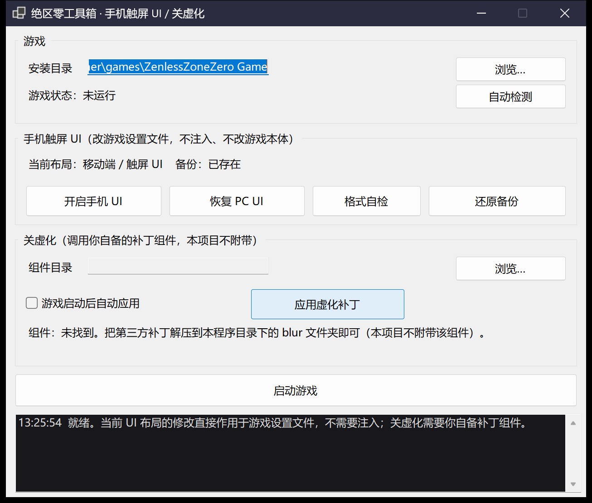

# 绝区零工具箱（ZZZ Toolkit）

一个带图形界面的小工具，用来在 PC 版《绝区零》上：

- **开关手机触屏 UI** —— 改游戏自己的设置文件，不注入、不改游戏本体
- **关虚化** —— 调用你自己准备的补丁组件（本项目**不附带**该组件）



---

## 一、手机触屏 UI

绝区零 PC 端其实内置了移动端（触屏）布局，走的是它自己的设置字段：

```
<游戏目录>\ZenlessZoneZero_Data\Persistent\LocalStorage\GENERAL_DATA.bin
    "LocalUILayoutPlatform" : 1     ← 移动端 / 触屏布局
    "LocalUILayoutPlatform" : 2     ← PC 布局
```

游戏内「设置 → 输入 → UI布局」改的就是这一项 —— 但**只有检测到触屏设备时那个选项才可选**，普通 PC 上点不到，所以只能用工具直接改文件。

这个文件被米哈游用社区称作 **Sleepy** 的格式包着（.NET BinaryFormatter 头 + XOR/逃逸字节编码），本项目的 `src/Sleepy.cs` 实现了它的编解码。**写入前会先做往返校验**（解码后再编码必须与原文件逐字节一致），不一致就直接拒绝写入 —— 避免游戏更新改了格式后把设置文件写坏。

改完值需要**重启游戏**才生效（游戏只在启动时读这个文件）。进入游戏后，HUD 会变成触屏布局：右下角圆形冲刺/攻击按键、左下虚拟摇杆区。

> 触屏布局是给触屏输入设计的。用鼠标推虚拟摇杆不一定有反应 —— 它的常见用途是**把 PC 画面串流到手机上玩**（Moonlight / UU 远程之类），或者用触屏笔记本。

## 二、关虚化

关闭「镜头贴近角色时的距离消隐 / 虚化着色器」需要给游戏进程注入一个补丁 DLL 并替换渲染相关着色器。**本项目不提供这个补丁载荷**，原因：

1. 那是第三方的作品，没有许可证，我们无权随本项目分发；
2. 注入用的二进制不适合让用户从陌生仓库随手下载执行。

所以本项目只提供**调用入口**，载荷由你自己准备：

1. 在程序目录下建一个 `blur` 文件夹；
2. 把你自备的补丁组件（注入器与它需要的 DLL）放进去；
3. 界面上「组件目录」指向这个文件夹（放在程序目录下的 `blur` 里会被自动识别）；
4. 游戏运行后点「应用虚化补丁」，或勾上「游戏启动后自动应用」让本工具盯着进程自动打。

组件里默认找名为 `loader.exe` 的入口；找不到时界面会明确告诉你去放文件。

> 相比原始方案（用 Windows 审核策略 + 进程创建事件计划任务来触发），本工具用「监视进程」的方式实现自动应用，**不需要改动系统审核策略**，也不会往系统里留计划任务。

## 三、用法

1. 下载 `ZZZToolkit.exe`，随便放哪（**别放进游戏目录**）。
2. 双击运行。程序会从注册表自动找游戏路径（米哈游启动器记录的那份），找不到就手动选。
3. 按需点「开启手机 UI」或「应用虚化补丁」。

界面上的其它按钮：

| 按钮 | 作用 |
|---|---|
| 自动检测 | 重新从注册表 / 常见路径找游戏目录 |
| 格式自检 | 检查当前游戏版本的设置文件能否被本工具无损解码，装新版本后建议先点一下 |
| 还原备份 | 首次改动时会留一份 `GENERAL_DATA.bin.bak`，一键还原 |

配置存在程序目录的 `zzz-toolkit.json`。

## 四、构建

需要 .NET 8 SDK。

```powershell
# 框架依赖版（约 190 KB，用户需要装 .NET 8 桌面运行时）
.\build.ps1 -Mode fx

# 自包含单文件版（约 66 MB，用户不用装任何运行时）
.\build.ps1 -Mode self-contained
```

产物在 `dist/` 下。

## 五、免责声明（请务必读）

- 本工具修改的是**游戏自己的设置文件**和（针对关虚化）游戏进程内存。这属于客户端修改，**可能违反游戏用户协议**。
- 社区里**有人报告**使用移动端 UI / 触屏模式后被限制联机或封禁（见 CollapseLauncher/Collapse#466 的讨论）。**请自行评估风险，本工具不承担任何后果。**
- 本项目**不附带、不下载、不推荐**任何第三方补丁载荷。
- 游戏更新后设置文件格式可能变化 —— 本工具的「格式自检」会告诉你还能不能用。

## 六、致谢

- 触屏 UI 的机制来自社区：`CollapseLauncher/Collapse#466` 的讨论（ubdjshdb 指出 `LocalUILayoutPlatform`），以及 [fffonion/ZZZConfigManager](https://github.com/fffonion/ZZZConfigManager)（Sleepy 编解码的实现参考）。
- 另一条更硬的路子是 [Jerry12228/TouchUILaunch](https://github.com/Jerry12228/TouchUILaunch)：注入 + 特征码扫描 + 打补丁，不依赖设置文件，但需要注入游戏进程。
- 本项目的代码（不含第三方组件）以 MIT 许可证发布，见 [LICENSE](LICENSE)。
